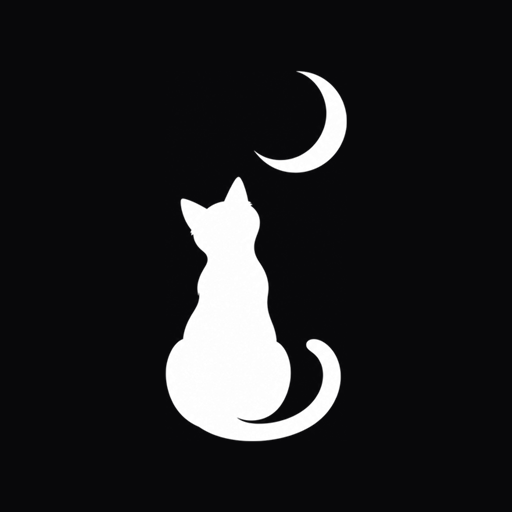

<p align="center"></p>

<h1 align="center">Moon Hub</h1>

<p align="center">Black themed Roblox UI library. Single file, responsive, 818 Lucide icons built in.</p>

## Load

```lua
-- Opens the showcase window with every element.
loadstring(request({ Url = "https://raw.githubusercontent.com/okame7x/moon-hub/main/MoonHub.lua", Method = "GET" }).Body)()
```

Use it as a library (no showcase):

```lua
getgenv().MoonHubDemo = false
local Library = loadstring(request({ Url = "https://raw.githubusercontent.com/okame7x/moon-hub/main/MoonHub.lua", Method = "GET" }).Body)()

local Window = Library:CreateWindow({
	Title = "Moon Hub",
	SubTitle = "Blox Fruits",
	ToggleKey = Enum.KeyCode.RightShift,
	-- Snow = false,          -- disable the snowfall
	-- ToggleButton = false,  -- hide the floating open/close pill
})

local Main = Window:AddTab({ Name = "Main", Icon = "home", Description = "Farming" })

Main:AddSection("Farm")
Main:AddToggle({ Name = "Auto Farm", Icon = "swords", Flag = "autoFarm", Callback = function(state) end })
Main:AddSlider({ Name = "Distance", Min = 0, Max = 60, Default = 25, Suffix = "m", Callback = function(value) end })
Main:AddDropdown({ Name = "Mode", Options = { "Level", "Mastery" }, Default = "Level", Callback = function(option) end })

Library:Notify({ Title = "Moon Hub", Content = "Loaded", Type = "Success" })
```

## Elements

| Method | Notes |
| --- | --- |
| `AddSection(text)` | Header with a fading line |
| `AddLabel(text)` | Returns `:Set(text)` |
| `AddParagraph({ Title, Content, Icon })` | Returns `:Set(title, content)` |
| `AddDivider()` | Thin separator |
| `AddButton({ Name, Description, Icon, Callback })` | Ripple on click |
| `AddToggle({ Name, Default, Flag, Callback })` | `:Set(bool)` |
| `AddSlider({ Name, Min, Max, Default, Decimals, Suffix, Flag, Callback })` | Value pill is editable |
| `AddDropdown({ Name, Options, Default, Multi, Searchable, Flag, Callback })` | `:Set(value)`, `:Refresh(list)` |
| `AddInput({ Name, Placeholder, Default, Numeric, OnlyOnEnter, Flag, Callback })` | `:Set(text)` |
| `AddKeybind({ Name, Default, Flag, Callback, ChangedCallback })` | Backspace clears |
| `AddColorPicker({ Name, Default, Flag, Callback })` | Saturation/value field, hue bar, hex box |

Every element accepts `Icon` (any Lucide name) and `Description`.

## Window

- `Window:SaveConfig(name)`, `Window:LoadConfig(name)`, `Window:ListConfigs()` store flags in `MoonHub/`.
- `Window:Toggle()`, `Window:SetVisible(bool)`, `Window:SetMinimized(bool)`, `Window:SetToggleKey(keyCode)`.
- `Window:SetToggleButtonVisible(bool)` shows or hides the floating open/close pill.
- `Library:Notify({ Title, Content, Duration, Type = "Info" | "Success" | "Warning" | "Error", Icon })`.

The logo is downloaded once into `MoonHub/logo_v1.png` and loaded with `getcustomasset`; executors without it fall back to a moon icon.
